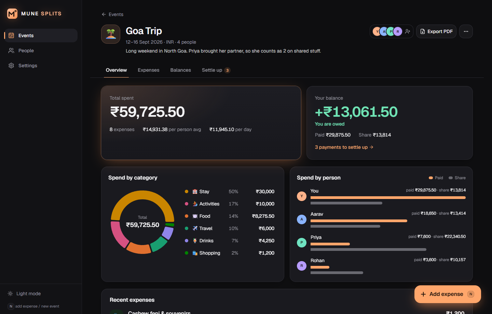
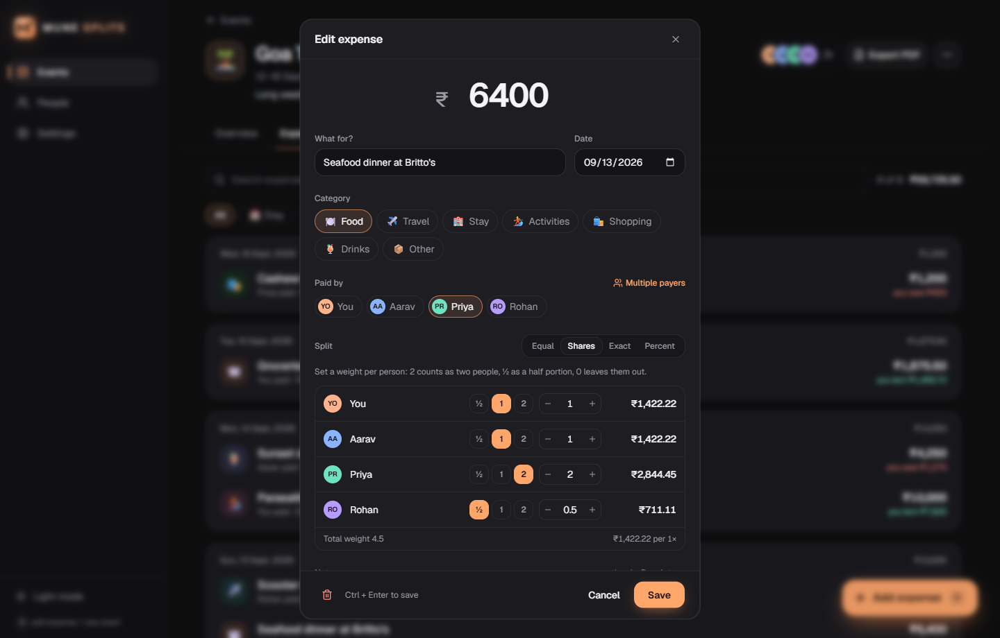
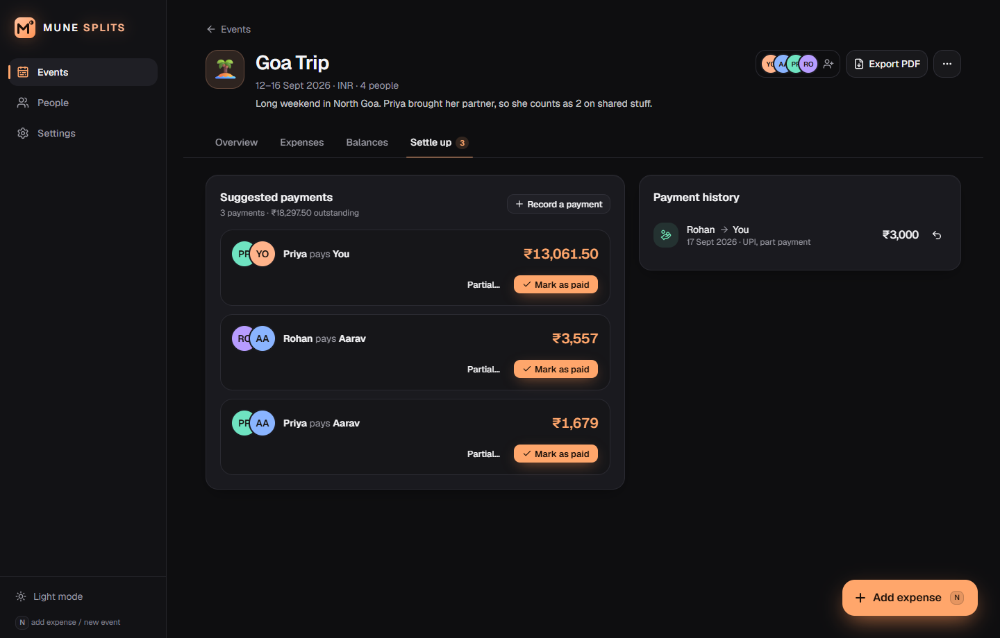
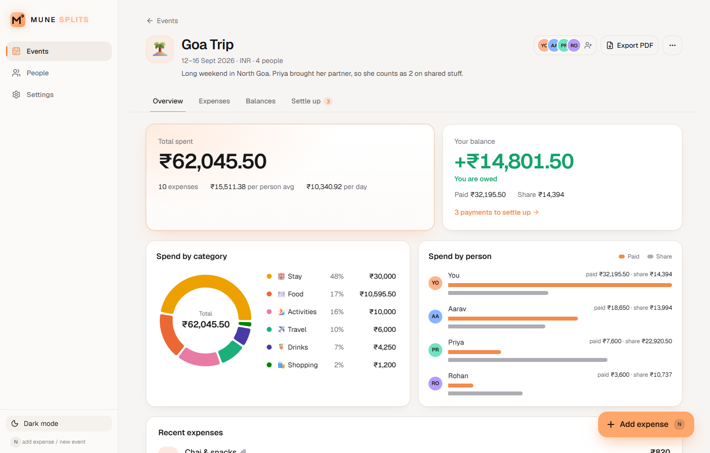

<p align="center">
  
</p>

<h1 align="center">MUNE Splits</h1>

<p align="center">
  Split trip and event expenses with friends. It works out who owes whom, and the fewest payments to settle up.<br>
  Local-first: your data never leaves your device. No accounts, no cloud, no tracking.<br>
  Runs on <b>Windows</b>, <b>Android</b> and <b>iPhone</b>.
</p>

<p align="center">
  <a href="https://github.com/tumune2119/mune-splits/releases/latest"><b>⬇ Windows</b></a>
  &nbsp;·&nbsp; <a href="https://github.com/tumune2119/mune-splits/releases/latest"><b>⬇ Android APK</b></a>
  &nbsp;·&nbsp; <a href="https://tumune2119.github.io/mune-splits/"><b>📱 iPhone &amp; web app</b></a>
  &nbsp;·&nbsp; <a href="#run-from-source-windows-macos-linux">Run from source</a>
  &nbsp;·&nbsp; <a href="docs/sample-report.pdf">Sample PDF report</a>
  &nbsp;·&nbsp; MIT licensed
</p>



## What it does

- **Events and trips:** a name, dates, currency, icon and colour. Filter by Active, Settled or Archived.
- **People:** a reusable list of friends. They're just names, with no sign-ups.
- **Expenses with four ways to split:**
  - **Equal:** tick who shares it.
  - **Shares:** a weight per person for that expense. `2` counts as two people (someone with their partner), `½` is a half portion, `0` leaves someone out. You see each person's amount as you type.
  - **Exact:** enter each amount. Saving is blocked until they add up.
  - **Percent:** must total 100%.
  - Plus **multiple payers** on one expense, notes, and receipt photos.
- **Balances:** see who owes whom as the fewest possible payments, or switch to the raw debts.
- **Settle up:** one click on **Mark as paid**, partial payments, undo, then lock the event as **Settled**.
- **Share it:** a polished **PDF report** ([example](docs/sample-report.pdf)), a print view, a WhatsApp-ready text summary, or CSV.
- **Dark mode by default** with a light theme, installable as an app, and it works offline.

| Weighted split | Settle up | Light mode |
| --- | --- | --- |
|  |  |  |

## Install on Windows (for friends: no setup needed)

1. Download **`MUNE-Splits-<version>-windows-x64.zip`** from the [latest release](https://github.com/tumune2119/mune-splits/releases/latest).
2. Right-click the zip, choose **Extract All…**, and open the extracted folder.
3. Double-click **`Install MUNE Splits.cmd`**.
   If Windows says *"Windows protected your PC"*, click **More info → Run anyway**. The app isn't signed with a paid certificate, but all the code is here to read.
4. MUNE Splits opens in its own window. You'll also have a desktop and Start menu shortcut.

Nothing else to install: Node.js comes bundled, and no admin rights are needed. To see how it works, try **Settings → Load demo trip**.

- **Update:** download the new zip and run `Install MUNE Splits.cmd` again. Your data is kept.
- **Uninstall:** **Settings → Apps → MUNE Splits → Uninstall**. You'll be asked whether to keep your data.
- **Closing:** close the window or click **Quit MUNE Splits**. The app stops in the background by itself.

## Install on Android

1. On your phone, open the [latest release](https://github.com/tumune2119/mune-splits/releases/latest) and download **`MUNE-Splits-<version>-android.apk`**.
2. Open the downloaded file. If Android asks, allow your browser or Files app to **install unknown apps**.
3. If Google Play Protect says it doesn't recognise the app, tap **More details → Install anyway**. It warns because the app isn't from the Play Store; all the code is here.
4. Open **MUNE Splits** from your app drawer.

**Update:** install the newer APK over the old one. Your data is kept.

## Use on iPhone (and any phone or computer)

Apple only allows App Store apps on iPhones, so for iPhone MUNE Splits is a web app you add to your home screen. It works the same way, offline, and keeps your data on the phone.

1. Open **[tumune2119.github.io/mune-splits](https://tumune2119.github.io/mune-splits/)** in **Safari**.
2. Tap **Share** (the square with an arrow), then **Add to Home Screen**, then **Add**.
3. Open **MUNE Splits** from the home screen. After the first visit it works with no internet connection.

On iPhone, open it from the home-screen icon rather than a Safari tab: Safari may clear data of websites you haven't visited for a few weeks, but home-screen apps are kept. Android phones can use the link too (Chrome menu → **Add to Home screen**).

> Each device keeps its own data; nothing syncs. To move or copy events between your computer and phone, use **Settings → Export all data** on one and **Import backup** on the other.

## Your data

Everything is stored on your device:

| | Windows (installed) | Windows (from source) | Android, iPhone, web app |
| --- | --- | --- | --- |
| Database | `%APPDATA%\MUNE Splits\mune-splits.db` | `data/mune-splits.db` | the app's private storage (IndexedDB) |
| Receipts | `%APPDATA%\MUNE Splits\receipts\` | `data/receipts/` | the same, next to the database |

On Windows, set `MUNE_SPLITS_DATA_DIR` to store it somewhere else. The desktop server only listens on `127.0.0.1` and rejects requests from other websites. The phone and web versions have no server at all: the database runs inside the app (SQLite compiled to WebAssembly).

**Backup:** **Settings → Export all data (JSON)** saves everything, including receipts. **Import backup** restores it, either merged with your current data or replacing it. A single event can also be exported as CSV from its ⋯ menu.

> Avoid keeping the live database in a synced folder (OneDrive, Dropbox) while the app is running: sync tools can conflict with SQLite. Use JSON backups instead.

## Run from source (Windows, macOS, Linux)

You need **Node.js 20** (22/24 also work after updating `better-sqlite3`, see below).

```bash
git clone https://github.com/tumune2119/mune-splits.git
cd mune-splits
npm install
npm run build
npm run preview      # → http://127.0.0.1:5174
```

For development, run `npm run dev` (port 5175, hot reload) and `npm test` (the split engine's unit tests).

On Windows you can also double-click **`Start MUNE Splits.bat`** in the repo. It installs dependencies, builds when the source changes, starts the server and opens an app window. `launch-mune-splits.vbs` does the same without a console window, and `create-shortcut.ps1` adds a desktop shortcut for it. Started this way, the server stops when you close the window.

**Install as an app (PWA):** with the app open in Chrome or Edge, use the install icon in the address bar. The local server still needs to be running.

## How the maths works

- Money is stored as **integer minor units** (paise or cents), so no floating-point errors creep in.
- A share is `amount × weight ÷ sum of weights`. Leftover paise go to the largest remainders, so shares always add up exactly to the total.
- **Net balance** = paid − share + payments sent − payments received.
- **Simplifying debts:** repeatedly match the largest creditor with the largest debtor. That takes at most *people − 1* payments. For example, if you paid ₹5,000 and a friend paid ₹2,000 for shared costs, that's one ₹1,500 payment, not two opposite debts.

The engine is a pure, framework-free module, [`src/lib/splits.ts`](src/lib/splits.ts), with tests in [`src/lib/splits.test.ts`](src/lib/splits.test.ts).

## Builds and releases

One codebase, three builds:

| Build | Command | What it makes |
| --- | --- | --- |
| Desktop | `npm run build` | Next.js server + SQLite file (what `Start MUNE Splits.bat` runs) |
| Windows installer | `npm run package:win` | `release/MUNE-Splits-<version>-windows-x64.zip` |
| Phone / web | `npm run build:local` | static files in `out/` with the database on the device (sql.js); Capacitor wraps them as the Android and iOS apps |

**Releasing a version:** bump `version` in `package.json`, then run `npm run package:win` and attach the zip to a release:

```bash
gh release create v0.2.0 release/MUNE-Splits-0.2.0-windows-x64.zip --title "MUNE Splits 0.2.0"
```

Pushing the `v*` tag (which `gh release create` does) starts the [Mobile workflow](.github/workflows/mobile.yml), which:

- builds the **signed Android APK** and attaches it to the release,
- compiles the **iOS app** as a check,
- deploys the **web app** to GitHub Pages. Every push to `main` does this too.

`npm run package:win` must run on 64-bit Windows with Node 20, because the bundled `better-sqlite3` binary has to match that Node version.

**Android signing:** APKs are signed with a release key kept in the repo's Actions secrets (`ANDROID_KEYSTORE_BASE64`, `ANDROID_KEYSTORE_PASSWORD`, `ANDROID_KEY_ALIAS`). Every update must use the same key, or Android refuses to install it over the old version. Forks need to create their own key.

**Working on the native apps:** `npm run android` opens Android Studio (it needs the Android SDK), and `npm run ios` opens Xcode (it needs a Mac). Both rebuild `out/` and run `npx cap sync` first.

**iPhone App Store:** the `ios/` project is ready, but publishing to the App Store or TestFlight needs a Mac with Xcode and an Apple Developer account. Until then, iPhones use the web app.

## Tech

Next.js 16 (App Router), React 19, TypeScript, Tailwind CSS 4, Radix and shadcn/ui-style components, SQLite (`better-sqlite3` on the desktop, `sql.js` on phones), Capacitor 7, Recharts, jsPDF and jspdf-autotable (with the embedded Inter font, so ₹ and other symbols render), and Vitest.

| Path | What's there |
| --- | --- |
| `src/lib/splits.ts` | split and settle engine (pure) |
| `src/lib/event-math.ts` | per-event balances, transfers and totals (shared by the UI, PDF and CSV) |
| `src/lib/core/` | the data layer: every read and write, on any SQLite (`store.ts`), plus shared validation (`service.ts`). Every event edit is one typed action (`src/lib/event-actions.ts`) |
| `src/lib/store.ts`, `src/app/api/` | desktop: the data layer on `better-sqlite3`, served over a local HTTP API |
| `src/lib/local/` | phones and web: the same data layer on `sql.js`, saved to IndexedDB |
| `src/lib/client/backend.ts` | the one interface every screen uses, so screens don't care which platform they're on |
| `src/lib/pdf.ts` | the PDF report |
| `src/proxy.ts` | blocks foreign `Host` headers and cross-site writes (desktop) |
| `android/`, `ios/` | Capacitor native projects |
| `packaging/windows/` | installer, launcher and uninstaller for the Windows zip |

`better-sqlite3` is pinned to `12.9.0` because it ships prebuilt binaries for Node 20. On Node 22 or 24, upgrade it to the latest version.

MUNE Splits is a sibling of MUNE TASKS and shares its look and launcher style.

## Contributing

Issues and pull requests are welcome. Before opening a PR, run `npm test`, `npm run typecheck` and `npm run lint`.

## License

[MIT](LICENSE). The Inter font is under the SIL Open Font License ([`public/fonts/Inter-OFL.txt`](public/fonts/Inter-OFL.txt)). The Windows release bundles Node.js under its own license (`node\LICENSE` in the zip).
